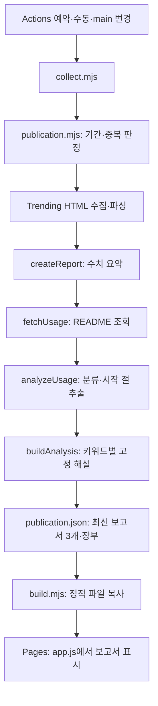
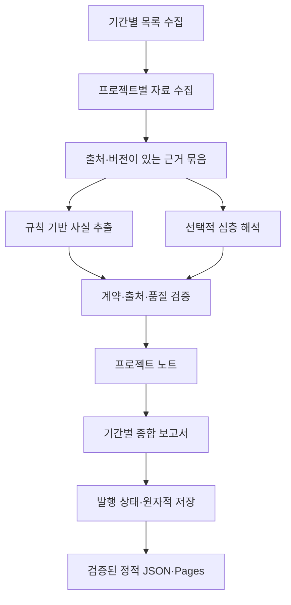

# 분석 품질 개선을 위한 아키텍처 검토

검토일: 2026-11-11 (한국 시간)

기준 커밋: `2a0c2c00e2bad87cb619a6f645584b26fe29bc91`

이 문서는 기준 커밋의 검토 결과와 후속 구현 설계안이다. 아래 진단·통계는 기준 커밋의 상태이며, 구현 진행 상황은 다음 기록을 따른다.

## 구현 진행 기록

2026-11-12 입출력 미확인 후속 보완: 30개 보고서 항목에서 입력 미확인 11→1개, 출력 미확인 10→1개로 줄였다. 설계 스킬의 페이지·컴포넌트 입력과 HTML·CSS 또는 기준 문서 출력, 보안 감사의 구조화 결과, CSV·은행 동기화, 팀 파일 가져오기·공유, 외부 에이전트의 스레드 요청·조회처럼 실제 문서에 명시된 경로를 추가했다. T3 Code는 README가 직접 연결한 `docs/user/outside-agents.md`를 수집 우선순위에 반영했다. 이 역할은 프로젝트 전체의 공통 입출력 계약이 아니며 각 경로의 설명으로 한정한다. Home Assistant의 자연어 작업 표는 사용 예·실행 미검증으로 표시한다. Java 알고리즘 모음의 공통 입력과 업무 플러그인 모음의 공통 출력은 근거가 없어 미확인으로 유지했다.

Astryx CLI README는 HTTP 200이며 압축된 응답 크기 표시는 25,906바이트였지만 읽은 본문은 352,891바이트였다. 기존 파일당 250,000바이트 상한에 걸린 것이므로 링크를 바꾸거나 상한을 풀지 않았다. 분석기 8에서 `document.links[].reason`으로 크기 제외·HTTP·시간 초과·네트워크·형식 오류를 분리하고 HTTP 오류는 상태 코드만 저장한다. 크기 제외는 README 성공·품질과 구분해 안내하고 확인 주기 안에는 반복 재시도하지 않는다. 주기 초과 또는 명시적 재확인에서는 정상 크기로 바뀌었는지 다시 읽는다. 일괄 수집 중 별도로 발생한 일시 시간 초과도 해당 문서만 재확인해 실제 크기 제외로 기록했고, 이미 읽은 문서의 SHA가 같아 본문은 재사용했다.

등록 구문 검사·테스트 117개·정적 빌드를 검증한다. 실제 문서 10개 프로젝트의 발췌, 미지원·예정 기능 배제, 문서 경로별 입출력, 압축 전송 크기와 본문 상한 구분, 제외·실패 사유와 재시도 정책을 포함한다. AI 비활성 일반 수집을 외부 요청 금지 상태로 재실행해 추가 요청 없이 보고서 해시가 유지됨을 확인했다. 브라우저에서 제외 경로·이유 표시, T3의 실제 추가 문서 근거 링크, Enter/Space·초점, 320px 모바일 가로 넘침·영문 본문 노출·콘솔 오류 없음을 확인했다. 발행 장부·최초 발행 시각을 유지했으며 AI 호출·노트는 0개다. 실제 도구 설치·실행을 검증한 것은 아니다.

연결 문서 확장 최종 검증: 등록 구문 검사 전체, 테스트 112개, 정적 빌드 통과. 배포 전 추가 파일까지 포함해 변경 검사를 수행한다. AI는 비활성 상태로 유지한다.

2026-11-12 연결 문서와 한국어 범위 보완: 배포 보고서 30개 항목·고유 저장소 27개를 점검했다. 핵심 동작 미확인은 일간 5개·주간 1개였다. README가 직접 연결한 같은 저장소·같은 참조의 Markdown 최대 2개를 추가 수집하는 `linked.mjs`를 도입했다. 영문판·사용 가이드를 우선하고 파일당 250,000바이트·15초, 전체 최대 750,000바이트로 제한한다. 외부 호스트·다른 저장소·다른 참조·재귀 링크 탐색은 제외한다. 파일 SHA와 경로가 포함된 출처별 근거 ID를 사용하며 동일한 제목·행 번호도 파일을 구분한다. 설치 조건의 부모 경로도 출처 ID를 포함해 찾는다.

README 조회 상태와 추가 문서 상태를 `document.status`·`document.links`로 구분한다. 추가 문서 실패 때는 읽은 문서만으로 분석하고 실패 문서의 이전 해설을 최신 정보로 유지하지 않는다. README는 정상일 수 있으며 품질은 남은 근거로 재평가한다. 실패 경로를 표시하고 다음 수집에 재조회한다. 전체 문서 SHA가 같아야 분석을 재사용하고 추가 문서만 바뀌어도 재분석한다. 분석기 7을 사용하며 구형 분석기 6의 한국어 문구를 현재 규칙과 강제로 일치시키지 않아 README 실패 시 이전 정상 분석을 보존할 수 있다.

실제 README와 추가 공식 문서 23개를 반영해 핵심 동작 미확인은 6→0개, 미분류는 5→0개가 됐다. 보고서 항목 기준 입력 미확인은 17→11개, 출력 미확인은 17→10개다. 시장 데이터·웹 개발 지침·코드 보안·Java 학습 자료·전통 명반 계산·구현 계획 작성 규칙을 보완했으며 문서에 없는 역할은 채우지 않는다. Astryx의 `packages/cli/README.md` 1개는 조회 실패로 표시하고 README 기반 설명을 유지했다. 발행 장부·최초 발행 시각을 보존했고 AI 호출·AI 노트는 0개다.

검증은 실제 미확인 6개 프로젝트의 고정 발췌와 모의 네트워크를 사용한다. 연결 문서의 원문·SHA·출처 연결, 추가 파일만 변경된 경우 재분석, 조회 실패 후 복구와 실패 파일 근거 제거, 크기·시간·도메인·개수 제한, 구형 결과 보존을 포함한다. 브라우저에서는 한국어 우선 표시, Enter/Space 근거 펼치기와 실제 추가 문서 링크, 실패 안내, 320px 모바일 가로 넘침·콘솔 오류 없음을 확인했다. 실제 설치·실행·성능 검증은 포함하지 않는다.

2026-11-12 한국어 우선 표시: 분석기 6에 `korean.mjs`를 추가해 확인된 동작 유형·입출력·조건을 한정된 한국어 규칙 요약으로 제공한다. 전체 README를 자유 번역하거나 AI를 호출하지 않는다. 핵심 동작 다음에 도입 시 주의점을 표시하고 필수·선택·필수 아님, 확인한 버전 조건을 보존한다. 영문 원문·목적 설명·저장소 소개·시작 절의 명령은 접힌 근거에서만 읽는다. 출처 본문은 보존하며 한국어 요약과 근거 참조를 계약 검증한다. 미지원 요약은 미확인으로 남기고 미분류 프로젝트의 범용 키워드를 구체적인 기능으로 해석하지 않는다.

기존 30개 항목은 이미 저장한 근거만으로 표시를 갱신해 문서 확인 시각·발행 장부·최초 발행 시각을 보존했다. 이어 새 날짜의 정상 수집을 AI 비활성 상태로 실행해 11월 12일 일간 발행호를 생성했다. 이는 표시 수정과 별개의 기존 일간 발행 정책이며 이전 장부와 주간·월간 발행 시각은 유지한다. 구문 검사·테스트 103개·정적 빌드를 검증하며, 브라우저에서 첫 화면의 긴 영문 문장 노출 없음, Enter/Space 원문 펼치기·접기와 초점, 320px 모바일 가로 넘침 없음·콘솔 오류 없음을 확인했다. AI 호출·AI 본문은 없으며 실제 설치·성능 검증은 포함하지 않는다.

후속 보고서 개선 검증: 구문 검사 전체·테스트 96개·정적 빌드 통과. 로컬 브라우저에서 새 핵심 판단의 근거를 Enter로 펼치고 초점을 유지했으며 320px 모바일에서 가로 넘침과 콘솔 오류가 없었다. AI 노트·호출은 없고 기존 발행 장부·최초 발행 시각이 유지됐다.

2026-11-11 배포 보고서 후속 검토: 공개 `reports.json`의 일간·주간·월간 30개 항목(고유 저장소 26개)과 연결된 실제 README를 읽었다. 핵심 판단이 12종류로 반복되고, 범용 기능 해설 4종류가 서로 다른 프로젝트에 반복됐다. `text-to-cad`의 배지 링크, Worktrunk의 인기 공지, Anthropic Skills의 구현 안내문이 목적처럼 표시되는 문제도 확인했다. 분석기 5에서는 문서 정제·목적 선택을 개선하고 실제 처리 방식·결과·제약을 우선 추출한다. 기능은 원문 설명으로, 검토 질문은 한국어 제안으로 분리하고 핵심 판단에 근거 ID를 연결한다. 같은 근거를 반복하는 기능은 합친다. 미확인 입출력을 분야 상식으로 채우지는 않는다.

동일한 보고서 목록을 실제 README 26개로 재분석했다. 고유 저장소 기준 핵심 판단은 12→26종류, 여러 저장소에 반복되는 기능 본문 종류는 4→0개, 핵심 기능을 추출하지 못한 저장소는 3→1개로 바뀌었다. 기간별 30개 항목 기준 입력 확인은 15→16개, 출력 확인은 13→15개, 부분 분석은 19→17개다. 단순히 문구를 다르게 만드는 것이 분석 품질의 증명은 아니므로 실제 문서 9개 발췌로 배지·안내문 배제, 서로 다른 디자인 스킬의 내용 차이, 프레임워크 동작·스냅샷 제약·판단 근거를 회귀 검증한다. 원문 인용을 자동 번역하지 않으며 미분류 문서와 문서에 없는 입출력은 계속 미확인으로 남는다. 발행 장부·최초 발행 시각을 보존했고 AI 호출과 AI 본문 저장은 0개다.

2026-11-11 최종 배포 전 점검: 1~5단계 전체의 등록 구문 검사, 테스트 90개, 정적 빌드와 `git diff --check`를 다시 통과했다. 현재 보고서 30개 항목을 계약 검증하고 기준 커밋과 발행 장부·최초 발행 시각이 같으며 AI 본문이 저장되지 않았음을 확인했다. 로컬 브라우저에서 실제 보고서의 키보드 근거 펼치기·주간 이동, 320px 모바일 가로 넘침 없음과 콘솔 오류 없음을 재확인했다. 비밀값 패턴 검사에서 일치 항목은 없었다. AI는 기본 비활성으로 배포하며 실유료 API 검증은 수행하지 않았다. 화면 읽기 프로그램의 실제 낭독, 설치·실행 성능 검증은 기존 제한으로 남는다. 이 기록은 원격 배포 성공을 의미하지 않으며 배포 결과는 Actions 실행으로 별도 확인한다.

2026-11-11: 5단계의 선택적 AI 심층 해석을 구현했다. 무료 규칙 분석을 기준으로 유지하고 `ai.mjs`가 공개 문서의 SHA·참조 근거 묶음에 한정해 도입 관점·제약과 절충·작은 검증 제안을 추가한다. 무제한 자유 글 생성 대신 세 종류의 구조화 해석을 선택했다. 인용 원문 일치 검사만으로 의미의 타당성을 알 수 없어 별도의 모델 근거 검토도 요구한다. 검토는 확률적 판단이며 실행·성능·사실 보증이 아니다. AI는 기본 분석 품질이나 규칙 기반 종합 집계를 바꾸지 않는다.

기본 비활성, 명시적 키·활성화·실행당 예산을 모두 요구한다. 첫 호출 전에 생성·검토 최대 예상 비용을 함께 예약하고 실패 뒤에도 반환하지 않는다. 요청·전체 시간, 프로젝트 수, 입력·응답 크기를 제한하며 자동 재시도하지 않는다. 시간 초과·사용량 이상 뒤에는 추가 호출을 중단한다. 고정 단가와 보수적 입력 추정을 사용한 실행당 제어이며 계정 전체나 월간 청구의 절대 상한은 아니다. 단가 유효기간 후 새 호출을 차단한다. [설정·비용 가정과 제한](ai-analysis.md)에 운영 방법을 기록했다.

근거 없는 출력·검토 거부·API 실패·예산 부족은 후보 본문을 버리고 규칙 분석으로 복구한다. 검증된 AI는 문서·입력·근거 지문으로 재사용하고 변경·오래됨 시 숨긴다. 검증·빌드 경계에서도 참조와 결과 해시를 확인한다. 화면은 추가 AI와 기본 판단을 분리하며 실패 시 원인을 짧게 알린다. 원본 API 오류·키·거부된 후보를 기록하지 않는다.

5단계 검증: 등록된 구문 검사 전체, 테스트 90개, 정적 빌드 통과. 모의 Responses 응답으로 생성·추가 검토 성공, 잘못된 인용·수치·의미 거부, 두 요청 사전 예약, 타임아웃과 이후 호출 중단, 응답·사용량 오류, SHA 재사용·무효화, 발행 장부 보존을 확인했다. 실제 수집 파이프라인에 모의 응답을 연결한 로컬 브라우저에서 채택·거부 카드, Enter/Space 근거 펼치기, 320px 모바일 가로 넘침 없음과 콘솔 오류 없음을 확인했다. 임시 서버는 종료·정리했고 모의 AI를 공개 데이터에 저장하지 않았다. 실제 유료 API·계정 권한·실제 모델 해석 품질은 검증하지 않았다. 키 등록·push·배포는 수행하지 않았다.

2026-11-11: 4단계의 판단·근거 중심 화면과 분석 상태 구분을 구현했다. 반복되던 소개·기능·조건을 정리하고 도입 전 판단, 미확인 항목, 문제와 입출력을 카드 앞에 배치했다. 설명 옆 원문 근거를 펼쳐 읽으며, 추가 조건·사용 흐름·시작 절차는 별도 상세 영역으로 접는다. CSS를 통합해 본문 가독성과 모바일 한 열 배치를 적용했다.

부분 분석(설명 범위)과 오래된 분석(문서 최신성)은 별도 배지와 텍스트로 표시한다. 재조회 실패와 단순 확인 주기 초과의 이유도 구분한다. 기본 항목 충족·오래됨이 동시에 가능하며, 화면의 오래됨 개수는 빌드가 전달한 주기와 렌더링 시각으로 계산한다. 미래·누락 시각은 최신으로 단정하지 않는다.

로딩 중 중복 요청을 차단하고 15초 제한과 오류 후 재시도를 적용했다. 전역 상태 안내를 별도로 두어 보고서 전체를 반복 낭독 대상으로 만들지 않는다. 결과·재시도 버튼으로 초점을 복구하되 기다리는 동안 사용자가 다른 곳으로 이동하면 초점을 유지한다. 본문 건너뛰기는 로딩 실패 중에도 선택 기간을 유지한다. 카드 한 건의 표시 오류를 해당 카드 안으로 제한한다.

브라우저에서는 검증 전용 고정 데이터로 503→지연→성공, 비활성 재시도 버튼, 같은 주간 결과로 복귀, 결과 제목 초점을 확인했다. 부분·오래됨, 충족·오래됨, 충족·확인 주기 이내 조합을 각각 확인했다. 실제 보고서와 고정 데이터 모두 데스크톱·모바일 너비에서 확인했고, 390px·320px 설정에서 가로 넘침이 없었다. Enter·Space로 근거 펼치기, Tab 이동, 본문 건너뛰기, 주간 전환을 확인했다. 주요 컨트롤 높이는 최소 44px였고 확인한 배지의 명암비는 7.41:1 이상이었다. 실제 보고서의 콘솔 오류는 없었다. 실제 화면 읽기 프로그램의 낭독이나 외부 접근성 인증을 수행한 것은 아니다.

4단계 최종 검증: 등록된 구문 검사 전체, 테스트 71개, 정적 빌드, `git diff --check` 통과. 중복 재시도 차단, 재실패 후 재시도, 잘못된 보고서 파일 복구, 카드 오류 격리, 오류 화면의 본문 건너뛰기 후 기간 유지, 사용자가 이동한 초점을 보존하는 동작을 포함한다. 검증 전용 서버와 임시 파일은 정리했고 배포 파일에는 포함하지 않았다. 수집·분석 본문·발행 장부를 갱신하지 않았으며 push·배포도 수행하지 않았다.

2026-11-11: 3단계의 프로젝트 분석 후 종합, SHA 기반 본문 재사용, 문서 최신성 검사, A→B→A 중복 판정 개선을 구현했다. `report.mjs`는 분류 분포·입출력 확인 범위·공통 항목을 같은 발행호의 근거에 연결한다. 미분류·부분 분석·조회 실패도 분모와 집계에 포함하고, 빌드 시 종합 문장·집계·참조가 원래 분석과 일치하는지 검사한다.

`freshness.mjs`는 기본 7일 확인 주기와 문서·분석 입력 지문을 관리한다. 별도 저장 캐시 대신 최신 보고서 3개를 재사용의 원천으로 삼는다. SHA·문서 경로·분석 입력·분석기 버전이 같으면 본문·근거·본문 분석 시각을 유지하고 정상 문서 확인 시각만 갱신한다. 다른 설명을 가진 같은 저장소의 분석도 각각 재사용할 수 있다. 조회 실패 시 마지막 정상 분석을 보존하고 오래됨을 표시하며 다음 실행에 재시도한다. 새 발행호도 유효한 기존 분석을 사용하므로 반복 조회를 줄인다.

중복 여부는 과거 장부 전체가 아니라 현재 표시 중인 같은 기간 보고서와 비교한다. A→B→A는 새 A 발행호가 되며, 숫자만 바뀐 동일 목록은 여전히 생략한다. 기존 장부는 삭제하거나 수정하지 않는다. 주·월 고정 발행호 정책과 통계 이력 미수집 정책도 유지한다.

실제 문서 재확인 후 30개 보고서 항목 중 29개는 본문을 재사용하고 1개는 재분석했다. 문서 확인 실패로 보존된 항목은 없었으며 기존 장부·최초 발행 시각을 유지했다. 직후 일반 수집을 다시 실행해 추가 변경 없이 종료됨을 확인했다. 데스크톱·모바일에서 분야 분포, 공통 조건별 원문 근거 펼치기, 키보드 Enter·Tab 조작, 주간 전환을 확인했고 가로 넘침과 콘솔 오류가 없었다.

3단계 최종 검증: 등록된 구문 검사 전체, 테스트 60개, 정적 빌드, `git diff --check` 통과. A→B→A 발행 복귀, 7일 확인 경계, SHA·경로·입력·분석기 변경, 서로 다른 설명의 캐시 선택, 조회 실패 후 복구, 근거 없는 종합 집계 거부를 포함한다. push·배포는 수행하지 않았다.

2026-11-11: 2단계의 용도 분류 확장과 프로젝트별 문제·입출력·도입 조건 설명을 구현했다. `profiles.mjs`는 README의 분류 근거를, `project.mjs`는 역할이 명시된 문장과 사용 예를 추출한다. 스키마 2·분석기 4로 갱신하고 이전 1단계 데이터도 읽을 수 있다. 문제·입출력·도입 조건이 비어 있으면 품질 미확인 항목에 포함한다. 필수·선택·불필요·언급을 설치 경로별로 구분하며, 사용 예의 입출력은 실행 미검증으로 표시한다.

같은 목록에서 미분류는 일간 8→0개, 주간 6→2개, 월간 3→1개로 줄었다. 30개 보고서 항목 모두 새 분석기로 갱신했고 장부·최초 발행 시각을 유지했다. 일간에는 문제 10개, 입력 5개, 출력 4개, 도입 조건 8개 항목을 확인했다. 분야 이름만으로 빈 항목을 채우지 않았으므로 이 수치는 지원 기능의 총수가 아니다. 원문 문제 설명·세부 조건은 원문 언어로 보존하고, 제한된 역할 해설만 한국어로 제공한다. 연결 문서 전체 수집과 자유 형식 심층 해석은 포함하지 않는다.

실제 README 7개의 고정 발췌와 같은 분야의 서로 다른 도구를 포함한 합성 문서로 평가한다. 로컬 서버를 호스트에서 실행해 데스크톱·모바일 너비에서 화면을 확인했다. 키보드 Enter로 상세 펼치기와 Tab으로 근거 링크 이동을 확인했고, 모바일에서 문서 너비와 화면 너비가 동일했으며 콘솔 오류가 없었다. 1단계의 브라우저 확인 차단과 달리 이번 화면 확인은 완료했다.

2단계 최종 검증: 등록된 구문 검사 전체, 테스트 44개, 정적 빌드, `git diff --check` 통과. API 제한 시 기존에 확인한 원문 경로 재사용·인증값 미전달, 수동 분석 재조회 시 장부·발행 시각 보존도 테스트했다. 원문 조회에 실패하면 이전 정상 분석을 보존하는 정책은 유지한다. push·배포는 하지 않았다.

2026-11-11: 1단계의 출처·근거 분리와 문서 조회 상태·분석 품질 분리를 구현했다. `evidence.mjs`, `contracts.mjs`를 추가하고 저장·빌드에서 참조 관계를 검사한다. 기존 보고서 30개 항목은 공개 README를 재조회해 갱신했으며 발행 장부와 최초 발행 시각을 보존했다. 품질의 `complete`는 분류·핵심 기능 근거·시작 경로가 있다는 뜻이고 화면에는 ‘기본 항목 충족’으로 표시한다. 단어 탐지 해설은 여전히 규칙 기반이며, 입력·출력 설명 확장·연결 문서 수집·심층 해석은 후속 단계다.

초기 검토에서 지적한 `fetcher` 전달 누락도 공통 주입으로 수정했다. 재조회 실패 시 이전 분석을 보존하면서 조회 실패·오래됨을 표시한다. 새 분석 포맷은 재조회로 이전 형식을 대체하며, 원문이 없는 이전 데이터의 근거를 역으로 생성하지 않는다. 통계 이력·중복 발행 판정·주월 발행 정책은 변경하지 않았다.

1단계 검증: 등록된 구문 검사 전체, 동작·렌더링 테스트 32개, 정적 빌드, `git diff --check` 통과. 실제 공개 README 재조회 후 모든 항목이 새 형식인지, 기존 장부와 세 보고서의 최초 발행 시각이 동일한지 확인했다. 브라우저 직접 검증은 내장 브라우저의 로컬 주소 연결 시간 초과와 Chrome 제어 승인 시간 초과로 미완료다. 렌더링 테스트는 실제 브라우저의 레이아웃·모바일·키보드 접근성 검증을 대신하지 않는다. push·배포는 하지 않았다.

## 1. 결론과 작업 범위

정적 사이트와 GitHub Actions는 유지한다. 분석이 얕아지는 주된 원인은 프런트엔드 프레임워크가 아니라 **제한된 입력, 키워드 기반 정형 해설, 근거와 해석이 결합된 데이터 구조**다. 프레임워크 교체나 서버·DB 도입을 우선할 이유는 없다.

우선 수집, 근거 추출, 분석, 종합, 발행의 책임을 분리한다. 비용 없는 근거 추출을 기본 경로로 두고, 프로젝트 고유의 비교와 해석은 같은 근거 묶음을 사용하는 선택적 분석 경로로 설계한다. 모델·유료 서비스는 이번 검토에서 선택하거나 연결하지 않는다.

## 2. 현재 흐름과 유지할 장점

- Node 내장 기능만 사용해 설치와 운영이 단순하다.
- 실패 시 이전 상태를 보존하고 파일을 임시 경로에 쓴 뒤 교체한다.
- 기간별 중복 발행, 한국 시간 경계, 재시도, README 실패 복구 테스트가 있다.
- 원문 명령을 임의 생성하거나 실행하지 않으며, 외부 문자열을 화면에서 이스케이프한다.
- 원본 HTML·README 전체를 별도 누적 저장하지 않고 최신 보고서만 공개한다.

## 3. 실제 데이터로 확인한 품질

clone한 커밋의 `content/publication.json`을 집계했다. 동일 프로젝트가 기간별로 중복되므로 아래 행을 합쳐 고유 프로젝트 수로 해석하면 안 된다.

| 보고서 | 프로젝트 | 용도 분류 미확정 | 핵심 기능 탐지 0개 | README 확인 불가 |
|---|---:|---:|---:|---:|
| 일간 | 10 | 8 | 4 | 0 |
| 주간 | 10 | 6 | 3 | 0 |
| 월간 | 10 | 3 | 0 | 0 |

README 조회가 모두 성공해도 유용한 분석이 만들어지지 않는다. 현재의 `ready`는 문서 처리 성공이지 분석 품질 통과가 아니다. 기능 개수도 깊이나 정확도를 보장하는 지표가 아니다.

## 4. 문제와 코드 근거

| 우선순위 | 문제 | 근거 | 결과 |
|---|---|---|---|
| P1 | 프로젝트마다 같은 해설 반복 | `analysis.mjs`의 `features`, `evaluation`, `verdict` | 탐지 단어와 분류가 같으면 작동 방식이 달라도 같은 설명이 나온다. |
| P1 | 입력이 README 한 파일로 제한됨 | `usage.mjs`의 `fetchUsage` | 실제 설치·설계 문서가 다른 파일에 있으면 구체적인 조건을 놓친다. |
| P1 | 분석 근거를 재검토하기 어려움 | finding에 절 제목과 `#readme`만 저장, `app.js`도 해당 링크로 통일 | 해설을 뒷받침한 정확한 문장·파일 버전을 찾기 어렵다. |
| P1 | 종합 요약이 프로젝트 분석을 사용하지 않음 | `publication.mjs`에서 `createReport` 후 `fetchUsage`; `trends.mjs` 요약은 순위·언어·스타 중심 | 분야별 흐름, 프로젝트 간 공통점, 도입 판단이 보고서에 반영되지 않는다. |
| P1 | 최신성 검사가 분석 버전에만 의존 | `publication.mjs`에서 동일 `usageVersion`의 `ready`를 건너뜀 | 같은 보고서에 남아 있는 분석은 README가 바뀌어도 조회하지 않는다. 새 보고서로 교체될 때는 다시 조회한다. |
| P1 | 품질과 성공 상태가 혼재 | `analyzeUsage`가 미분류·기능 0개에도 `ready` 반환 | 확인할 내용이 부족해도 정상 상세 분석처럼 표시된다. |
| P2 | 과거 어느 시점과 동일해도 발행 생략 | `fingerprint`는 숫자를 제외하고 장부 전체에서 동일 해시 검색 | A→B→A로 돌아온 목록도 생략돼 화면에는 B가 남을 수 있다. 단순 중복 방지와 최신 목록 제공의 목적이 충돌한다. |
| P2 | 주간·월간은 해당 기간 첫 처리 후 수집 생략 | `issueKey`와 장부 확인 | 현재 구조는 고정 발행호다. 매일 갱신되는 rolling Trending 대시보드와 다르므로 화면에서 발행 기준을 명확히 해야 한다. |
| P2 | 관측 이력이 없음 | 최신 보고서와 해시 장부만 저장 | 순위 상승·신규 진입·증가율·인기 원인을 근거 있게 설명할 수 없다. |
| P2 | 외부 의존성 주입이 부분적 | `collectPublication`의 `fetcher`가 기본 `fetchUsage`에 전달되지 않음 | 수집과 README 조회의 테스트·네트워크 정책이 서로 다른 경로로 흐른다. |
| P2 | 데이터 계약 검증 부족 | 빌드는 JSON 파싱 후 복사, 화면은 `reports` 객체만 검사 | 일부 필드 오류가 전체 화면 렌더링 실패로 이어질 수 있다. |

분류 표현을 더 추가하는 것만으로는 첫 네 문제를 해결할 수 없다. 코드 블록을 모두 제거한 뒤 기능을 탐지하는 현행 방식도 SDK 호출·입출력 예시의 중요한 근거를 놓친다. 예시는 문서 설명과 구분해 추출하되 명령은 실행하지 않아야 한다.

## 5. 제안하는 책임 분리

파일 분리는 해당 단계 구현 시 진행한다. 현재 규모에서 저장소 패턴, 서비스 계층, 범용 플러그인 시스템은 추가하지 않는다.

| 모듈 제안 | 책임 | 하지 않는 일 |
|---|---|---|
| `sources.mjs` | README·선별 문서 조회, 크기·횟수 제한, 응답 상태 | 해석 생성, 파일 속 명령 실행 |
| `evidence.mjs` | 제목·문단·예시 추출, 근거 ID·파일 SHA·링크 생성 | 단어 등장만으로 기능 지원 확정 |
| `analysis.mjs` | 근거를 이용한 프로젝트별 구조화 노트 | 목록 수집, 발행 장부 수정 |
| `report.mjs` | 완성된 노트와 같은 기간 수치의 종합 | 관측하지 않은 성장 원인 생성 |
| `contracts.mjs` | 저장·빌드 경계에서 입력 및 산출물 검증 | 모든 오류를 정상 데이터로 변환 |
| `publication.mjs` | 일정·중복·이전 정상 결과 보존·저장 대상 조정 | 문서 파싱과 본문 작성 |

모든 네트워크 경로에는 같은 `fetcher`, 시간, 재시도 정책을 전달한다. 연결 문서는 README가 명시한 저장소 내부 문서부터 최대 2개를 추가 조회하는 안으로 시작한다. 문서별 250KB, 프로젝트별 750KB를 상한으로 제안하며 실제 API 제한과 실행 시간을 측정한 뒤 조정한다. 임의의 외부 URL 크롤링과 대안 저장소 자동 탐색은 초기 범위에서 제외한다.

## 6. 분석 데이터와 독자에게 보여줄 내용

저장 스키마 버전과 분석기 버전을 분리한다. `status`는 `complete`, `partial`, `unavailable`로 구분하고, 문서 수집 상태는 별도로 둔다. 아래 필드는 제안이며 현행 JSON에 이미 존재하는 필드가 아니다.

| 데이터 | 핵심 필드·규칙 |
|---|---|
| 출처 | `id`, `repository`, `path`, `sha`, `section`, `url`, `fetchedAt` |
| 근거 | `id`, `sourceId`, 짧은 원문 발췌, 문서 내 위치 |
| 주장 | `kind: documented / interpretation`, `text`, `evidenceIds` |
| 프로젝트 노트 | 해결 문제, 입력→처리→출력, 차별점, 적용 예, 환경·운영 부담, 적합·보류 조건, 미확인 질문 |
| 품질 | 핵심 설명 존재 여부, 출처 없는 주장, 미확인 항목, 생성 방식·버전 |
| 최신성 | `sourceCheckedAt`, `analyzedAt`, `analyzerVersion`, `sourceFingerprint`, `stale` |

‘문서에 적혀 있다’는 작성자의 주장 확인이다. 실제 실행 검증이나 독립적인 성능 확인으로 표시하지 않는다. 분석기의 해석에는 관련 근거 ID와 판단 이유를 연결한다. 비교 대상도 근거 묶음에 없으면 우월성·성능 비교를 작성하지 않고 추가 확인 항목으로 남긴다.

기본 화면은 프로젝트별 핵심 문제, 구체적인 동작, 도입 판단을 짧게 보여주고 상세에서 근거와 시작 절차를 제공한다. 비슷한 분류라는 이유만으로 같은 본문을 복제하지 않는다. 근거가 부족하면 짧은 부분 분석을 보여준다. 긴 면책 문구로 공백을 채우지 않는다.

종합 보고서는 프로젝트 노트 생성 후 작성한다. 확인된 용도 분포와 같은 목록의 공통 접근, 독자가 살펴볼 이유를 제시한다. 미분류는 분모에서 숨기지 않는다. 분야 비중은 수집 상위 10개의 특성으로 한정하며 전체 생태계의 시장 점유율로 표현하지 않는다.

## 7. 비용과 저장 정책 결정

### 기본 결정

- 정적 HTML/CSS/JS, Node 내장 기능, Actions, Pages를 유지한다.
- 무료 기본 경로에서는 근거 추출과 사실 요약을 개선한다. 자유로운 기술 해석까지 규칙만으로 해결한다고 약속하지 않는다.
- 모델을 도입한다면 구조화 근거를 입력으로 받고 같은 계약을 출력하는 선택 경로로 둔다. 모델 실패 시 검증된 사실 요약으로 복구하며, 유료 키는 자동 추가하지 않는다.
- 원본 전체 대신 짧은 근거 발췌와 파일 SHA를 저장한다. 근거 링크는 가능한 경우 커밋에 고정하고, 파일이 README가 아닐 때도 실제 파일로 연결한다.
- 저장소 ID별 최신 분석을 재사용하고, 보고서는 발행 당시 분석을 포함한다. 현행 발행 장부는 유지한다.

### 기존 정책과 충돌하는 항목

| 항목 | 현재 | 권고·대안 |
|---|---|---|
| 무료·무인 운영 | 규칙 기반만 사용 | 무료 경로부터 개선. 심층 해석은 이후 비용·실행 환경 결정에 따라 선택. |
| 통계 이력 없음 | 변화 분석 불가 | 초기에는 유지. 순위 변화가 필요할 때만 관측시각·기간·순위·스타의 제한된 이력을 별도 설계. 과거 데이터는 소급 생성하지 않음. |
| 주·월 발행 | 첫 정상 실행 때 고정 | 우선 유지하고 발행 시점을 표시. 매일 rolling 목록을 보여주는 정책 변경은 발행호와 분리해서 결정. |
| 중복 판정 | 과거 전체 동일 해시로 생략 | 최신 보고서와 동일할 때만 생략하는 방향 권고. A→B→A 회귀 테스트 필요. |
| 정상 분석 재사용 | 버전만 같으면 유지 | 문서 확인 유효기간을 별도로 도입. 7일을 초기 제안으로 두고 SHA가 같으면 분석 재사용. |

분석 캐시는 최신 보고서 3개에 등장하는 프로젝트만 유지하는 제한부터 적용할 수 있다. 캐시와 이력은 목적이 다르며 캐시 추가를 장기 통계 수집으로 확대하지 않는다.

## 8. 실패·재시도·품질 기준

- 기간별 필수 목록 수집 실패는 현재처럼 해당 실행의 새 발행을 중단하고 이전 정상 상태를 보존한다.
- 프로젝트 문서 일부 실패는 나머지 프로젝트 발행을 막지 않는다. 이전 분석이 있으면 유지하고 오래됨·조회 실패를 별도로 표시한다.
- 구조가 틀린 분석이나 출처를 참조하지 못하는 주장은 발행 전에 거부한다. 정상 문서가 부족한 경우는 `partial`로 명시한다.
- `collectedAt`, `sourceCheckedAt`, `analyzedAt`, `publishedAt`을 구분한다. 본문만 보완했을 때 최초 발행 시각을 바꾸지 않는다.
- 품질 지표는 미분류율·근거 없는 주장 수·재사용률·문서 실패율을 기록한다. 문장 수나 탐지 기능 수만으로 통과시키지 않는다.
- 렌더러는 잘못된 프로젝트 한 건 때문에 전체 보고서가 사라지지 않게 하고, 로딩·빈 결과·오류·재시도·키보드 접근을 유지한다.

## 9. 구현 순서와 완료 조건

1. **데이터 계약과 근거 분리:** 문서 처리 성공과 분석 품질 분리, 출처 ID·파일 SHA·짧은 근거 추출. 시작 절·예시·미지원 표현·문서 실패를 재현하는 fixture로 검증한다. 출처 없는 기능 단정을 막는 것이 완료 조건이다.
2. **프로젝트 고유 설명:** 주요 용도를 넓히고 문제·입출력·도입 조건을 실제 문서에서 추출한다. 다양한 분야의 고정 fixture에서 같은 키워드를 가진 서로 다른 프로젝트가 각자의 근거로 설명되는지 확인한다. 미분류율만 줄이기 위한 억지 분류는 허용하지 않는다.
3. **종합 보고서와 최신성:** 프로젝트 노트 후 요약, SHA 기반 재사용, 조회 실패 시 이전 분석 보존, A→B→A 중복 판정 개선. 기존 장부·발행시각을 유지하는 마이그레이션을 검증한다.
4. **화면 반영:** 핵심 판단과 근거를 표시하고 부분 분석·오래된 분석을 구분한다. 데스크톱·모바일·키보드 조작, 로딩 실패 후 재시도를 브라우저에서 확인한다.
5. **선택적 심층 해석:** 무료 경로의 한계를 평가한 뒤 모델 또는 편집 경로를 결정한다. 도입 시 비용 상한, 타임아웃, 잘못된 출력 거부, 근거 부족 시 복구를 먼저 검증한다.

초기 평가 세트는 현재 일간·주간·월간에 등장하는 고유 프로젝트에서 분야와 문서 형태가 겹치지 않게 선정한다. 원문 일부를 고정 fixture로 두고 수동 검토한 기대 사실·미지원 사실을 기록한다. 파서 테스트 통과와 글의 유용성 평가는 별도 결과로 보고한다.

## 10. 이번 검토의 검증과 제한

- 원격 저장소를 `D:\project\github-trend-journal`에 clone하고 기준 커밋과 작업 트리 상태를 확인했다.
- Node.js `v24.22.1`에서 package.json의 검사 대상 8개 파일을 `node --check`로 확인했다.
- `node --test`: 기존 동작 테스트 20개 통과.
- `node scripts/build.mjs`: 기존 publication.json으로 정적 빌드 성공.
- 주입한 가짜 HTML과 시각으로 A→B→A 일간 수집을 실행해, 마지막 입력 A가 `skipped-identical`로 처리되고 화면 데이터에는 B가 남는 동작을 재현했다. 외부 요청과 저장 파일 변경은 하지 않았다.
- 현재 셸에서 npm 명령을 찾지 못해 같은 스크립트를 Node로 직접 실행했다. TypeScript·ESLint 설정은 없다.
- 실시간 Trending·README 전체 재수집, GitHub Actions 실행, Pages 배포, 브라우저 화면 검증은 수행하지 않았다. 화면·실행 로직은 이번에 수정하지 않았다.
- 테스트 통과는 기존 구현의 회귀 기준이다. 제안 아키텍처가 구현되었거나 분석 품질이 개선되었다는 뜻은 아니다.

## 대표 항목 분석 보완 (2026-11-12, 분석기 9)

모음 전체에 단일 입출력을 부여하는 대안은 항목별 계약 차이를 숨기므로 채택하지 않았습니다. Java의 이진 탐색·버블 정렬, 업무 플러그인의 PRD 작성·통화 후 요약에 한해 공식 문서의 실제 연결 경로를 확인합니다. Java는 Javadoc만 읽고 원본 절 시작 행을 유지합니다. 대표 문서는 별도 근거 문맥으로 분리해 일반 분류와 공통 입출력에 혼입되지 않도록 했습니다. 각 예의 사용 예·입력·출력·주의점은 같은 항목의 근거를 갖추어야 하며 변경·누락 시 보류합니다.

고정된 두 항목 이외의 재귀 탐색과 코드 실행은 하지 않습니다. 일반 문서 2개와 대표 문서 2개까지 허용하지만 기존 프로젝트 총량 750,000바이트를 실제 스트림 읽기 단계에서 제한합니다. 대표 문서 SHA도 기존 지문에 포함하므로 같은 입력은 재사용하고 변경 시 재분석합니다. 대표 설명은 공통 품질 미확인 항목을 해소한 것으로 계산하지 않으며 화면에서 범위를 명시합니다. AI는 비활성 상태를 유지합니다.
